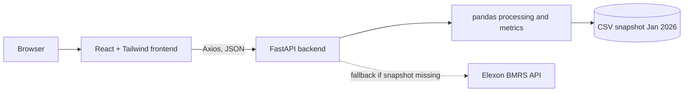

# Wind Forecast Analytics Platform (WindWatch)

A web app that helps a UK energy utility's day-ahead trading team understand **which wind forecast was available when they had to decide**, and **how accurate it was**.

> **AI disclosure:**AI tools, including Claude, were used to assist with brainstorming, code generation, and documentation. All generated content was reviewed, tested, and adapted, and I understand the implementation and functionality of the final solution.

**Live app:** `<FRONTEND_URL>`
**API:** `<BACKEND_URL>` (interactive docs at `<BACKEND_URL>/docs`)

## Problem

A utility buys power on the UK day-ahead market, and decisions for delivery day D are made on day D−1. Wind generation is weather-dependent, so the team relies on forecasts to decide how much extra power (e.g. from thermal plants) to buy. This app:

1. Shows the latest wind forecast **available at decision time** against what was actually generated.
2. Quantifies forecast error (MAE, RMSE, MAPE, bias) so decisions can account for it.

Scope: national-level wind only, Elexon data only (`FUELHH` actuals, `WINDFOR` forecasts), decisions for January 2026.

## Key method

Many forecasts are published for each half-hour slot. For every target time we keep **only the latest forecast published before the decision cut-off** (default: 12:00 UTC on the day before delivery), then join it to the actual generation for the same time. Error = forecast − actual.

The cut-off is an **assumption**, so it is adjustable in the UI (06:00 to 16:00). Reviewers can see how accuracy changes with decision time.

## Architecture



## Tech stack

- **Frontend:** React (Vite), Tailwind CSS v4, React Router, Axios, Recharts, React Icons
- **Backend:** Python, FastAPI, pandas, NumPy, Requests
- **Infra:** Docker, Docker Compose, Vercel

## Repository structure

```
.
├── backend/
│   ├── app.py                 FastAPI app and routes
│   ├── services/
│   │   ├── elexon.py          fetch Elexon data; read snapshot first, download as fallback
│   │   ├── processor.py       pick latest forecast before cut-off, join with actuals, compute error
│   │   └── metrics.py         MAE, RMSE, MAPE, bias, etc.
│   ├── data/                  committed Jan 2026 snapshot (actual.csv, forecast.csv)
│   ├── requirements.txt
│   └── Dockerfile
├── frontend/
│   ├── src/
│   │   ├── pages/             Dashboard, Analytics, About
│   │   ├── components/        Layout, Sidebar, Navbar, StatCard, FilterBar, DataTable, charts/
│   │   ├── context/           shared decision-time state
│   │   ├── hooks/             useFetch, useTheme
│   │   ├── services/api.js    Axios API layer
│   │   └── utils/             formatters, stats, filters, CSV export
│   ├── nginx.conf             serves the built app in Docker
│   ├── vercel.json            SPA rewrite for Vercel
│   └── Dockerfile
├── docker-compose.yml
└── README.md
```

## Running the app

### With Docker (recommended)
```bash
docker compose up --build
```
Frontend: http://localhost:3000. API docs: http://localhost:8000/docs.

### Without Docker
```bash
# backend
cd backend
python -m venv venv
venv\Scripts\activate        # Mac/Linux: source venv/bin/activate
pip install -r requirements.txt
uvicorn app:app --reload

# frontend (new terminal)
cd frontend
cp .env.example .env
npm install
npm run dev
```
Frontend: http://localhost:5173.

## API endpoints

| Endpoint | Description |
|---|---|
| `GET /` | Health check |
| `GET /forecast` | All wind forecasts (startTime, publishTime, generation) |
| `GET /actual` | Actual wind generation (startTime, generation) |
| `GET /comparison?decisionHour=12` | Latest forecast before cut-off joined with actuals, plus error |
| `GET /metrics?decisionHour=12` | MAE, RMSE, MAPE, bias, max/min error, averages, record count |
| `GET /latest?decisionHour=12` | Most recent comparison row |

## Features

- Summary cards: latest forecast, latest actual, error, accuracy, MAE, RMSE, MAPE, bias
- Forecast vs actual line chart; error trend, daily average, over/under split and error distribution charts
- Data table with search, sorting, pagination and CSV export
- Filters: date, time of day, generation range, forecast publish date, plus reset
- Adjustable decision time
- Light/dark theme, responsive layout, loading skeletons, error and empty states with retry

## Assumptions and limitations

- Decision cut-off of 12:00 UTC the day before is assumed, not an official rule.
- Data is hourly where forecasts exist; only timestamps present in both datasets are compared.
- MAPE skips hours where actual generation is zero.
- Filters apply to the chart and table; summary metrics cover the whole month.
- All times are UTC (equal to UK time in January).

## Future improvements

- Compute metrics for the filtered range on the backend
- Test suite for the processor and metrics
- Live refresh from Elexon on a schedule instead of a static snapshot
- Compare several decision times side by side

## My journey

I came into this project knowing **Python and React**, but with two firsts: I had **never used Docker**, and I had **never built a data project** (working with real datasets, joining them and measuring accuracy).

**What was new to me**
- **Data work:** the hardest idea was that a forecast isn't one number. Many forecasts exist for the same time slot, so the real question is *which one was available when the trader had to decide*. Solving this with pandas (cut-off time, latest forecast, join with actuals) taught me to think about data in terms of time, not just columns.
- **Forecast accuracy metrics:** I learned what MAE, RMSE, MAPE and bias each tell a decision-maker, and why the sign of the bias matters more than the average size of the error in a purchasing context.
- **Docker:** I learned the difference between a Dockerfile, an image and a container, why a React app is built and served by nginx in production, and why the browser must call the backend at `localhost`, not at the container name.
- **Deployment constraints:** I found that serverless platforms have read-only filesystems, which led me to ship a committed data snapshot with a download fallback.

**How I worked**
I used AI tools (Claude) as a guide and pair-programmer, as disclosed above. I ran each step, checked the results against the API and the charts, and committed after every component so the git history shows the build order. Where I'm unsure, I've listed it under *Assumptions and limitations* instead of hiding it.

This project taught me a lot in a short time, and I would happily take on the improvements listed above.